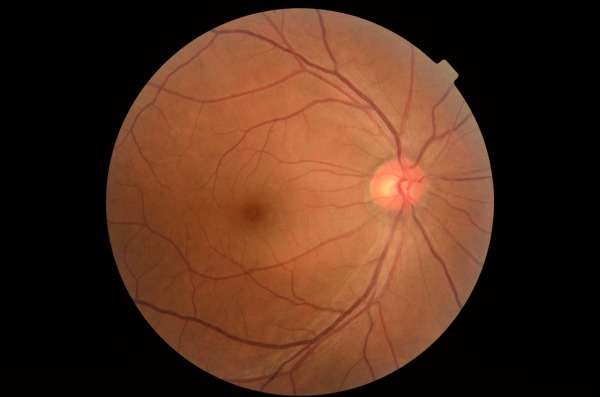
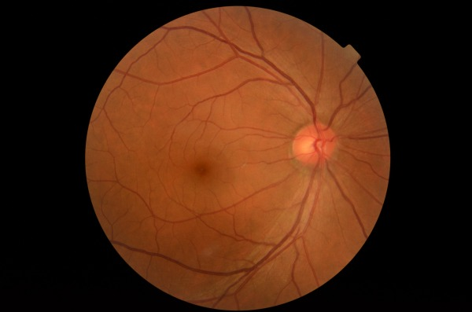
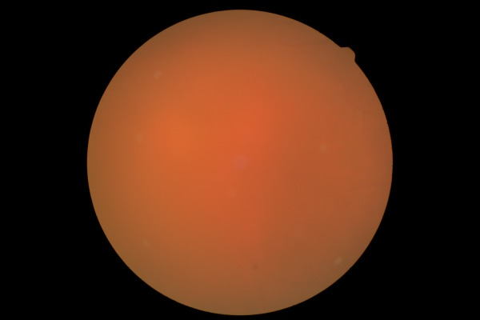
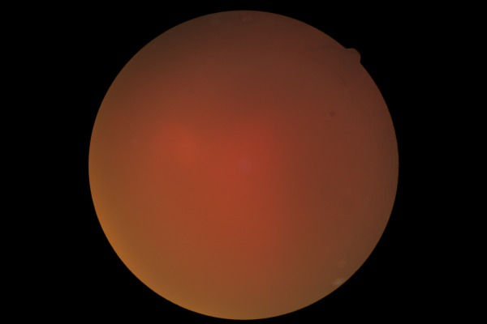
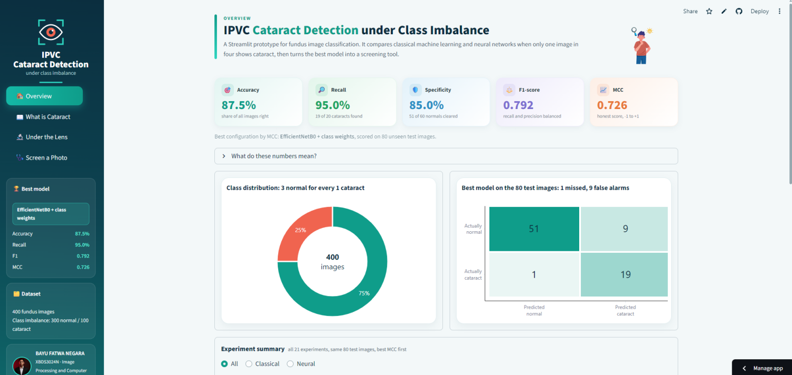
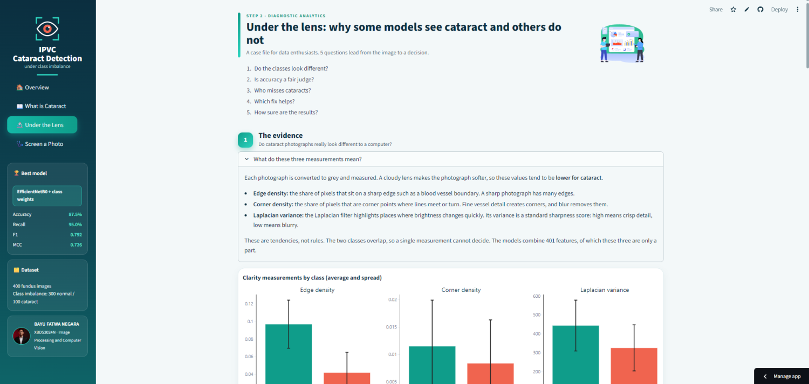
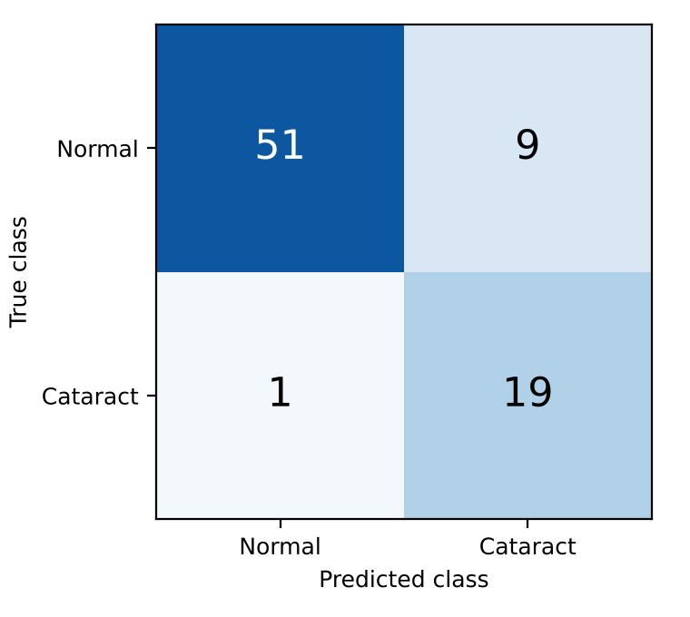
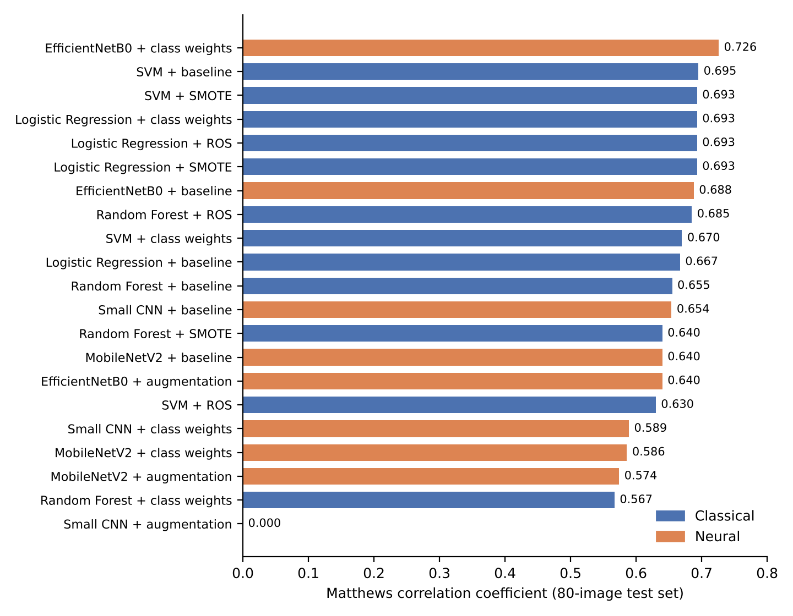

<h1 align="center">👁️ IPVC Cataract Detection Dashboard</h1>
<p align="center"><i>A data-driven Streamlit application that tells the story of cataract screening from fundus photographs, under class imbalance.</i></p>

<p align="center">
  <!-- Shields.io Badges -->
  
  
  
  
  
  
</p>

<p align="center">
  <b>🔗 Live app:</b> <a href="https://cataract-detection-dashboard.streamlit.app/">https://cataract-detection-dashboard.streamlit.app/</a>
</p>

---

## 🌟 Overview
**IPVC Cataract Detection** is the dashboard that accompanies a course project for **XBDS3024N Image Processing and Computer Vision**. It asks one question: *can a photograph of the back of the eye flag a cataract, even when only one image in four shows cataract?*

The project uses **400 colour fundus photographs** (300 normal, 100 cataract) and compares **6 models across up to 5 imbalance-handling strategies, 21 experiments in total**, on 80 unseen test images. The dashboard turns those results into a four-step story that follows the four types of data analytics:

| Step | Analytics type | Question it answers |
|---|---|---|
| 1 | **Descriptive** | What is cataract, and what does the dataset look like? |
| 2 | **Diagnostic** | Why do the classes differ, why does accuracy mislead, who misses what, and how sure are the results? |
| 3 | **Predictive** | What does the model say about this fundus photograph? |
| 4 | **Prescriptive** | What should happen next, and which model and cutoff suit a clinic? |

All powered by **Streamlit**, **Plotly**, **TensorFlow**, **scikit-learn**, **OpenCV** and **custom CSS**.

---

### 🖼️ What the Model Sees
Two normal and two cataract fundus photographs from the dataset. A cloudy lens softens the cataract photographs, which lowers the sharpness measurements the models learn from.

<table align="center">
  <tr>
    <td align="center"><br><sub>Normal</sub></td>
    <td align="center"><br><sub>Normal</sub></td>
    <td align="center"><br><sub>Cataract</sub></td>
    <td align="center"><br><sub>Cataract</sub></td>
  </tr>
</table>

---

### 🏠 Overview Page
Headline metrics of the best model, the class split, its confusion matrix and a filterable table of all 21 experiments.

<p align="center"></p>

### 📖 What is Cataract: Descriptive Analytics
Causes, symptoms, a blur simulator that shows how a clouded lens softens a photograph, and the dataset split.

<p align="center"></p>

### 🔬 Under the Lens: Diagnostic Analytics
A case file of interactive charts: clarity features by class, the accuracy trap, missed cataracts and false alarms, which imbalance strategy helps, how sure each result is, and a live cutoff slider.

<p align="center"></p>

### 🩺 Screen a Photo: Predictive and Prescriptive Analytics
Upload or pick a fundus photograph, see what the computer measures, read the model's result, and get advice and a screening policy.

<p align="center"></p>

---

## 🚀 Live UX Highlights
- **Image validity check** that rejects anything that is not a colour fundus photograph before a model sees it
- **Transparent processing panel**: original, CLAHE-enhanced image, Canny edges and Harris corners
- **Result card with a score gauge** and an adjustable decision threshold
- **Result-based advice** with a hospital contact
- **Policy lab** that ranks the 21 configurations by expected cost
- **Plain-language glossaries** for every metric, strategy and clarity measurement
- **Automatic fallback**: if TensorFlow cannot load on the server, the app uses the lighter SVM + SMOTE model

---

## 🗂️ Main Features

### 🧪 Models and Imbalance Handling
- **Classical ML:** SVM, Random Forest, Logistic Regression on 401 handcrafted features (colour, texture, shape, clarity) reduced with PCA
- **Deep learning:** Small CNN, MobileNetV2 and EfficientNetB0
- **Strategies:** baseline, class weights, random oversampling (ROS), SMOTE and augmentation
- **Metrics beyond accuracy:** recall, specificity, F1, MCC, ROC-AUC and Wilson confidence intervals

### 📊 Data Analytics
- Violin plots and Mann-Whitney tests of the clarity measurements
- Accuracy versus recall scatter that exposes a model predicting only "normal"
- Strategy heat map and repeated cross-validation results
- Cutoff slider that redraws recall, specificity and the confusion matrix live

### 🛣️ Guided Screening
- **Cataract signal:** next steps, symptoms to note, and when to seek urgent care
- **No signal:** routine check-ups and eye-protection habits, with a reminder that "no signal" is not a clearance

---

## 🏆 Best Result (80 unseen test images)

| Model | Accuracy | Recall | Specificity | F1 | MCC |
|---|---|---|---|---|---|
| **EfficientNetB0 + class weights** | 87.5% | 95.0% | 85.0% | 0.792 | 0.726 |

The best classical model, the SVM baseline, reached MCC 0.695. The Small CNN with augmentation scored 75% accuracy but found no cataract, which shows why accuracy alone misleads.

<table align="center">
  <tr>
    <td align="center"><br><sub>EfficientNetB0 + class weights: 1 missed cataract, 9 false alarms</sub></td>
    <td align="center"><br><sub>MCC of all 21 experiments</sub></td>
  </tr>
</table>

---

## 🧩 Project Structure
```text
📁 Cataract-Detection-Dashboard/
│
│── 📄 app.py
│
│── 📂 assets/
│   ├── 📂 data/            # CSV files exported from the notebook
│   ├── 📂 animations/      # Lottie JSON files
│   ├── 📂 img/             # author photo and sample fundus images
│   └── 📂 models/          # EfficientNetB0 (.keras) and SVM + SMOTE (.joblib)
│
│── 📂 components/
│   ├── 📄 home_lottie.py
│   ├── 📄 fundus_utils.py  # validation, preprocessing, features, model scoring
│   ├── 📄 data.py
│   ├── 📄 charts.py
│   ├── 📄 glossary.py
│   └── 📄 ui.py
│
│── 📂 tabs/
│   ├── 📄 overview.py
│   ├── 📄 what_is_cataract.py
│   ├── 📄 under_the_lens.py
│   └── 📄 screen_yourself.py
│
│── 📂 docs/                # figures used in this README
│
│── 📂 Cataract Classification/
│   └── 📄 Cataract_classification.ipynb
│
│── 📂 .streamlit/
│   └── 📄 config.toml
│
│── 📄 requirements.txt
└── 📄 README.md
```

---

## ▶️ Run Locally
```bash
python -m venv .venv
.venv\Scripts\activate          # Mac/Linux: source .venv/bin/activate
python -m pip install -r requirements.txt
python -m streamlit run app.py
```
Use **Python 3.12** (TensorFlow supports 3.9 to 3.13).

---

## 🛠️ Tech Stack
- **Python 3.12**
- **Streamlit**: interactive web app
- **Plotly**: interactive visualisations
- **TensorFlow / Keras**: EfficientNetB0 inference
- **scikit-learn**: classical models, PCA, metrics
- **OpenCV and scikit-image**: preprocessing and feature extraction
- **SciPy**: statistical tests
- **Pandas / NumPy**: data handling
- **Lottie**: animated illustrations
- **Custom CSS**: teal and coral theme

---

## ⚠️ Disclaimer
This dashboard is a **student research demonstration, not a medical device**. It does not give a diagnosis. Only an eye-care professional can diagnose a cataract. Uploaded images are processed in memory and are not stored.

---

## 📚 Credits
- Fundus images: [yiweichen04/retina_dataset](https://github.com/yiweichen04/retina_dataset)
- Lottie animations: reused from the *Student Mental Wellness Dashboard* project

---

🧑‍💻 Developed by:

- **Bayu Fatwa Negara bin Alias**

Course: XBDS3024N Image Processing and Computer Vision. This dashboard is developed for educational and academic purposes.
